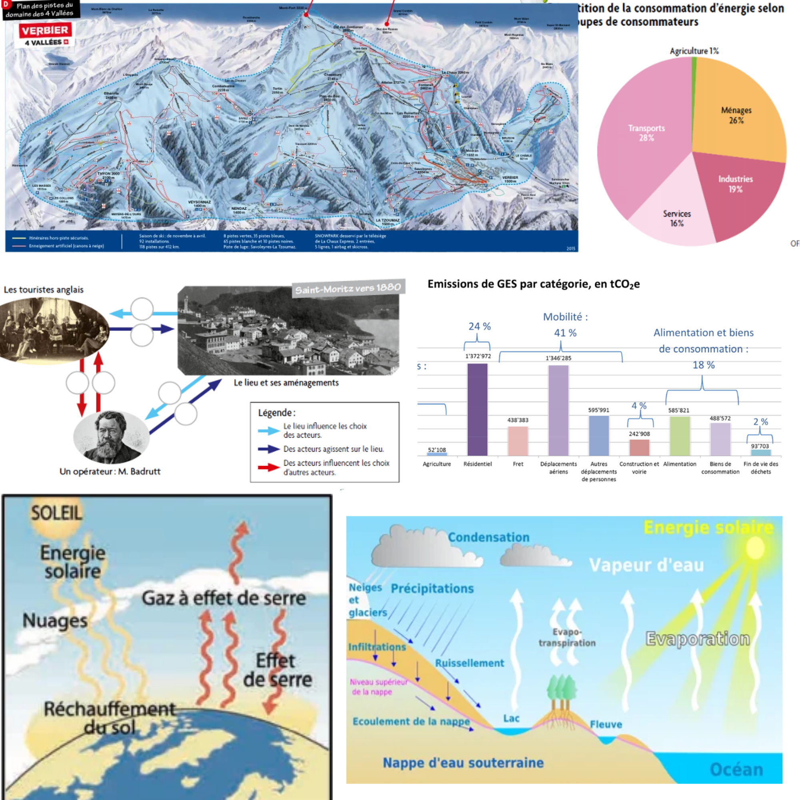

Le projet ECOopération propose des séances d'apprentissage coopératif, basées sur le plan d'études romand (niveaux 7H et 8H).
Les séances s'inscrivent en Mathématiques & Sciences de la Nature et Sciences Humaines & Sociales.

Le matériel a été testé auprès de 1483 élèves de Suisse Romande, et a fait l'objet d'un [[article scientifique.]](https://psycnet.apa.org/fulltext/2028-41305-001.pdf){:target="_blank"}

Vous pouvez utiliser librement le matériel pour les classes de [[7H]](https://kdrive.infomaniak.com/app/share/288729/64c905df-dff6-46e8-82d4-e696a8e8d088){:target="_blank"}
et pour les classes de [[8H.]](https://kdrive.infomaniak.com/app/share/288729/5d0a1e87-76d5-4f23-8abe-e5fcee537d44){:target="_blank"}
Vous trouverez également les illustrations en couleur [[ici]](https://kdrive.infomaniak.com/app/share/288729/929df0d0-6d46-474e-a4e6-3b1e2023ae3c){:target="_blank"}
